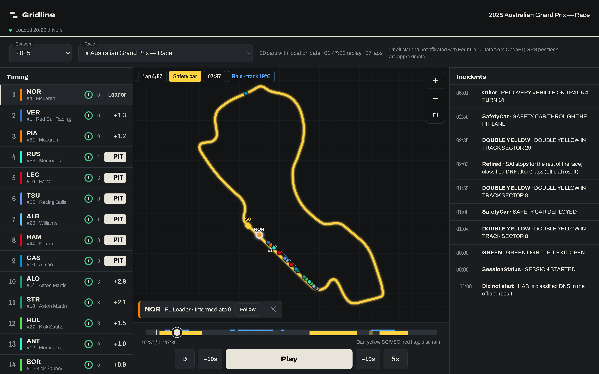
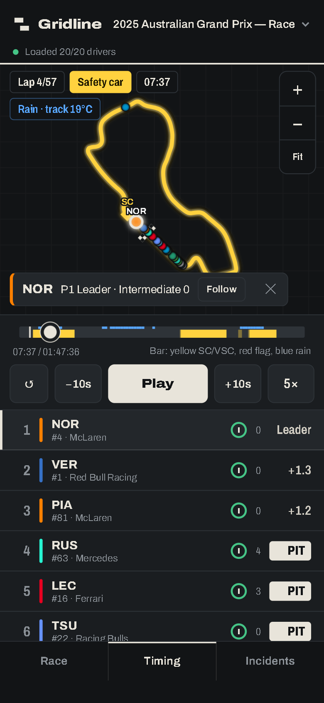
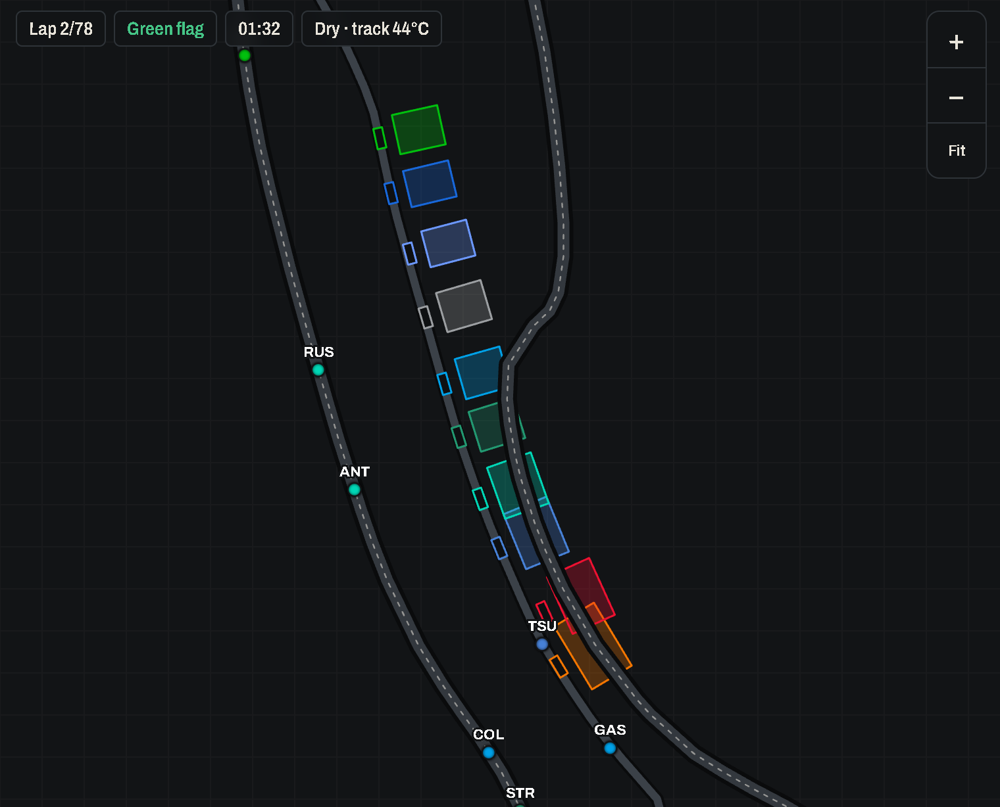
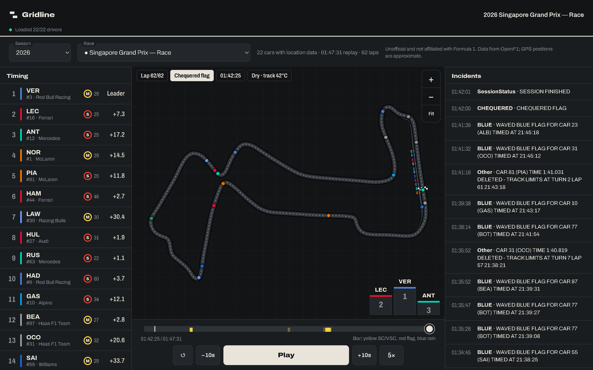

# Gridline

A browser-based 2D replay of real Formula 1 races, driven by **recorded GPS telemetry** rather than simulation. Pick any Race or Sprint from 2023 onward and watch every car move around the circuit with the timing tower, race-control incidents, safety car, flags, weather and tyres following along.

It is a static web app: plain HTML, CSS and JavaScript on a canvas, no build step and no dependencies. Data comes from the free [OpenF1](https://openf1.org) API.

> Unofficial fan project, not affiliated with or endorsed by Formula 1, the FIA or any team. GPS positions are approximate.



## Features

- **Replay from recorded positions.** Cars are interpolated between real GPS samples. A car with no data at a given moment is hidden, never frozen in place.
- **Timing tower** with running order, interval to the car ahead, tyre compound and age, PIT and DNF/DNS labels. Tap a row or tap a car on the track to select it; a chip on the track shows its position, gap and tyre.
- **Follow mode.** Zoom in and follow the selected car as it moves.
- **Race control.** Incident log that only shows what has happened by the replay time, and a flag state derived from the log (safety car, VSC, red flag, yellow sectors, chequered flag). Scrubbing backwards restores the correct state.
- **Scrubber with history.** The playback bar shows when the safety car, VSC, red flag and rain occurred.
- **Weather and tyres.** Dry/rain with track temperature, tyre compound and age for every driver.
- **Pit lane and garages** drawn from where cars actually drove and stopped, plus the **safety car** when OpenF1 has its position.
- **Podium** after the chequered flag.
- **Mobile first.** Pinch to zoom, pan, bottom tab bar on phones; three columns on wide screens.
- **Works offline** for any session you have downloaded into `data/`.

## Screenshots

| Phone | Pit lane and garages | Podium |
| --- | --- | --- |
|  |  |  |

The first screenshot is the 2025 Australian Grand Prix under the safety car in the rain (the blue pill and the blue line on the scrubber are rain). The others are the 2025 Monaco Grand Prix and the 2026 Singapore Grand Prix.

## Quick start

Gridline needs to be served over HTTP (browsers block some requests from `file://`). Any static server works.

```bash
# Node (also enables saving downloaded races, see below)
node scripts/serve.mjs            # http://localhost:8765

# or Python
python -m http.server 8765
```

On Apache/XAMPP, drop the folder in `htdocs` and open `http://localhost/gridline/`.

The app opens on the latest finished race. Choose a season and race from the **Race** tab (phones) or the strip at the top (desktop). Races already downloaded into `data/` are marked ● and load straight away; otherwise press **Load race data** to fetch it live from OpenF1 (about 40 seconds).

## Downloading races for offline use

Live loading pulls roughly 15 MB of location data per race, so it is worth keeping a local copy.

**From the app.** If the page is served by `scripts/serve.mjs` or by PHP with `save.php`, every race you load from the API is saved into `data/` automatically. Otherwise, Chromium browsers can save into a folder you choose with **Choose data folder…**.

**From the command line.**

```bash
node scripts/fetch-session.mjs 9693 9523        # by OpenF1 session key
node scripts/fetch-session.mjs --year 2024      # every Race and Sprint of a season
node scripts/fetch-session.mjs 9693 --force     # re-download a cached session
```

Downloads are written to `data/<season>/<session_key>/` and listed in `data/index.json`. The folder is git-ignored; a full 2023 to present download is about 1.5 GB.

A race is **not** cached if OpenF1's GPS for it ends well before the race does. The app still opens such a race, shows a "No GPS after …" notice, and does not mark cars as retired because their data stopped.

## How it works

Everything is reconstructed from OpenF1 data at load time; nothing is hand-drawn.

| Thing | How it is derived |
| --- | --- |
| Circuit outline | One driver's single, gap-free timed lap (fastest clean lap that passes jump and closure checks). The feed's `(0,0)` "no fix" samples are discarded. |
| Start/finish marker | GPS position at the lap-timing instant, drawn perpendicular to the track tangent. |
| Replay clock | 0 at `SESSION STARTED` (negative before it), ending shortly after `SESSION FINISHED`. |
| Pit lane | Path of every recorded pit stop between pit entry and exit, averaged, joined to the racing line at both ends. |
| Garage boxes | Where each team's cars stood still for 2 to 14 seconds in the pit lane. A team without such a stop gets no garage. |
| Stopped cars | A car is only treated as stopped if it sat still for 2 minutes of recorded data. The official `session_result` is used for DNF and DNS. |
| Flag state | Race-control messages replayed in order up to the current time, respecting scope (sector, track). |
| Marshal sectors | **Not drawn.** OpenF1 numbers them but gives no geometry, so sector yellows appear only as a label. |

Data used: `sessions`, `meetings`, `drivers`, `location`, `position`, `laps`, `intervals`, `pit`, `stints`, `weather`, `race_control`, `session_result`.

## Known limits

- Location data is only available from 2023 onward, and some races have gaps or stop early.
- Rain is a yes/no flag about once a minute; weather is for the whole circuit.
- Pit stops depend on OpenF1's pit feed. Where it is missing (2023) the stop windows are estimated from pit-out laps.
- GPS jitter means cars can appear slightly off the racing line; the pit lane and garages are approximate.
- Garage sizes are estimated from the spacing of stopping spots, not measured.

## Project layout

```
index.html              the whole app (HTML, CSS, JS)
save.php                optional: lets the page save downloaded races (Apache/PHP, localhost only)
scripts/serve.mjs       static server that also accepts saves (Node)
scripts/fetch-session.mjs   command-line downloader
data/                   downloaded sessions (git-ignored)
docs/screenshots/       images used in this README
```

`save.php` and `serve.mjs` only accept JSON files under `data/`, only from the local machine, and reject other hosts. Do not expose either to the internet.

## Credits and licence of the data

Telemetry and timing come from [OpenF1](https://openf1.org). Check their terms before redistributing downloaded data, which is why `data/` is not part of this repository. Formula 1 and related marks belong to their owners; this project uses no official logos or assets.

## Licence

The code is released under the [MIT License](LICENSE). This covers the source in this repository only, not OpenF1 data or Formula 1 trademarks.
